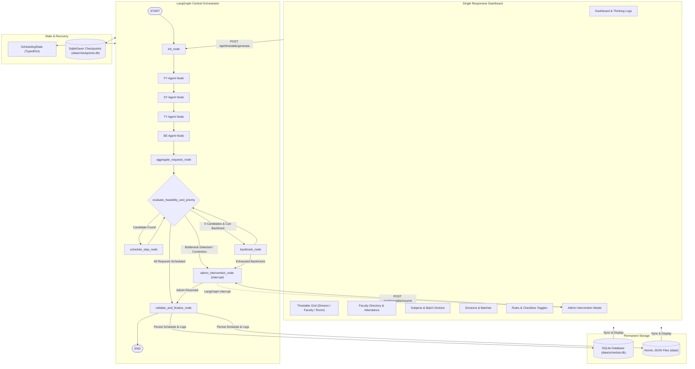

# Schedula: Multi-Agent Intelligent Timetable Scheduling System (CMPN)

A production-grade, local-first intelligent timetable scheduling system for Computer Engineering (CMPN) departments. It synchronizes and generates conflict-free weekly schedules across all academic years (**Second Year (SY)**, **Third Year (TY)**, etc.) simultaneously, properly managing shared faculty pools, classrooms, specialized laboratories, divisions, practical batches, and institutional workload rules.

---

## ⚡ Quick Start (One-Click Run on Windows)

Simply double-click or run:
```bat
run.bat
```
This batch script automatically:
1. Detects Python 3.10+ and automatically sets up a local virtual environment (`venv`).
2. Installs required dependencies (`Flask`, `langgraph`, `pytest`, `gunicorn`).
3. Starts the local Schedula server.
4. Opens your default web browser directly to `http://127.0.0.1:5000`.

**Default Login:**
* **Username:** `admin`
* **Password:** `admin123`

---

## 1. Project Overview

In collegiate engineering departments, scheduling cannot be performed independently for each academic year. Faculty members teach subjects across FY, SY, TY, and BE, and laboratories (such as Computer Labs, Networking Labs, and AI Labs) are shared departmental facilities. Independent scheduling causes deadlocks and severe cross-year resource conflicts.

**Schedula CMPN** solves this by unifying all four academic years under a **LangGraph (Python StateGraph)** orchestration framework driven by four dedicated rule-based agents (`FYAgent`, `SYAgent`, `TYAgent`, and `BEAgent`), paired with **Minimum Remaining Values (MRV)** heuristic ordering, dynamic priority calculation, **Future Flexibility Protection**, persistent **SQLite Checkpoint Recovery**, and dual storage (Relational SQLite `data/schedula.db` + Atomic JSON `data/*.json`).

---

## 2. Main Features

- **LangGraph Central Orchestrator:** Unifies all four years in a single cyclical state graph with conditional edges, dynamic priority recalculation, backtracking, and interrupt/resume functionality.
- **Four Independent Deterministic Agents:** FY, SY, TY, and BE agents operate as pure Python functions without requiring non-deterministic LLMs.
- **Human-in-the-Loop Admin Intervention:** Uses LangGraph's native `interrupt()` and `Command(resume=...)` to pause execution on resource bottlenecks, allowing administrators to review bottlenecks and approve or redirect generation.
- **Persistent LangGraph Checkpointer:** Uses `SqliteSaver` in `data/checkpoints.db` for workflow state tracking and recovery.
- **Permanent SQLite Storage:** Relational database storage in `data/schedula.db` with relational schema for all entities, execution logs, and timetables.
- **Coordinated 4-Year Scheduling:** Generates FY, SY, TY, and BE schedules together with 0 cross-year resource conflicts.
- **Shared Faculty & Room Management:** Tracks faculty teaching occupancy and specialized laboratory equipment across all years.
- **Two Administrative Roles (RBAC):**
  - **Main Admin:** Full control over global rules, working hours, breaks, workload limits, faculty additions/deletions, rooms, and complete timetable generation.
  - **Academic Admin:** Manages subjects, divisions, practical batches, subject requirements, and manual timetable entries.
- **Exact Interval Clash Detection:** Detects overlapping minutes (e.g. `09:30–10:30` clashing with `09:00–10:00`) rather than relying on discrete slot string comparisons.
- **Practical Batch Support:** Handles division sub-batches (e.g., Batch A1, A2, A3) running concurrent or dedicated 2-hour laboratory sessions.
- **Future Flexibility Protection:** Protects pending cross-year requests before committing shared faculty to tentative slots.
- **Manual Timetable Editing & Smart Suggestions:** Allows admins to add, move, or delete lectures manually. When an invalid move is attempted, the system rejects it, pinpoints the exact conflict, and provides instant clickable suggestions for clash-free slots.
- **Automatic Backups:** Generates snapshots before destructive changes (generation or reset).

---

## 3. Technology Stack

- **Frontend:** HTML5, CSS3, Vanilla JavaScript (ES6+), responsive single dashboard (No React, Angular, or external UI libraries).
- **Backend:** Python 3.11+, Flask 3.1+ REST API.
- **Orchestration Framework:** **LangGraph (Python)** `StateGraph` with conditional routing, persistent `SqliteSaver` checkpointer, and `interrupt()` / `Command(resume=...)` support.
- **Agent Architecture:** Deterministic Python rule-based agents (`FYAgent`, `SYAgent`, `TYAgent`, `BEAgent`, `FacultyManager`, `RoomManager`, `ConstraintValidator`, `FeasibilityEngine`, `PriorityEngine`, `FlexibilityEngine`).
- **Permanent Storage:**
  - Relational SQLite: `storage/sqlite_store.py` (`data/schedula.db`)
  - Checkpoint SQLite: `langgraph.checkpoint.sqlite.SqliteSaver` (`data/checkpoints.db`)
  - Atomic JSON files: `storage/json_store.py` (`data/*.json`)
- **Testing:** Automated test suite with 25 unit and integration tests using `pytest`.

---

## 4. Architecture & Workflow



---

## 5. Installation & Setup Instructions

### Prerequisites
- Python 3.10+ installed on your system.

### Step 1: Clone or navigate to the project directory
```bash
cd d:\college\PROJECTS\Schedula
```

### Step 2: Create and activate virtual environment
**On Windows (PowerShell):**
```powershell
python -m venv venv
.\venv\Scripts\Activate.ps1
```
*(If PowerShell restricts scripts, run `Set-ExecutionPolicy -Scope Process -ExecutionPolicy Bypass` or activate via CMD `.\venv\Scripts\activate.bat`)*

**On Linux / macOS:**
```bash
python3 -m venv venv
source venv/bin/activate
```

### Step 3: Install dependencies
```bash
pip install -r requirements.txt
```

---

## 6. How to Run Locally

### Option A: One-Click Docker (Recommended)
Simply double-click:
```
start-docker.bat
```
*(or run `docker compose up --build -d` in terminal)*

This automatically:
- Checks Docker installation and engine status.
- Builds the production multi-stage image.
- Launches the Schedula container with persistent `./data` mounting.
- Verifies the health check and opens `http://localhost:5000` in your browser.
- To stop the container, double-click `stop-docker.bat` (or run `docker compose down`).

### Option B: One-Click Native Python (Windows)
Simply double-click:
```
start.bat
```
*(or `run.bat`)*

This automatically:
- Detects or initializes the Python virtual environment (`venv`) and installs dependencies if needed.
- Starts the Flask backend server.
- Opens your default web browser directly to `http://127.0.0.1:5000`.

### Option C: Manual CLI Run
With your virtual environment activated:
```bash
python app.py
```
*(Or directly using the virtualenv executable: `.\venv\Scripts\python.exe app.py`)*

Open your web browser and navigate to:
```
http://127.0.0.1:5000
```

---

## 7. Administrator Credentials

The system uses a single Administrator account:

| Role | Username | Password | Permissions |
|---|---|---|---|
| **Administrator** | `admin` | `admin123` | Full control over global rules, working days, timings, breaks, workload toggles, faculty additions/renaming/deletions, rooms & labs, subjects & assignments, divisions & batches, complete timetable generation, manual editing, and full data reset. |

---

## 8. Reset & Data Management Buttons

1. **⚡ Generate Timetable:** Coordinates and schedules all user-entered data across FY, SY, TY, and BE simultaneously.
2. **🗓️ Reset Timetable:** Clears only the generated timetable entries while retaining all your faculty, subjects, divisions, batches, and rooms.
3. **🗑️ Reset All Data:** Completely wipes all departmental data (faculty, divisions, batches, rooms, subjects, assignments, timetable, and logs) so you can start completely fresh. An automatic snapshot backup is preserved in `data/backups/`.

---

## 9. Key Features & Workflows

### 9.1 Empty Clean Database
- All data files in `data/*.json` (`faculty.json`, `divisions.json`, `batches.json`, `subjects.json`, `rooms.json`, `faculty_assignments.json`) are initialized clean and empty (`[]`) so you can enter your own actual department data from scratch.

### 9.2 Student Strength & Room Capacity
- **Divisions:** Specify student strength when adding a division (e.g. 70 students).
- **Practical Batches:** Specify batch strength when adding a batch (e.g. 25 students).
- **Rooms & Labs:** Specify room seating capacity (e.g. 75 for classrooms, 30 for labs).
- **Automatic Capacity Enforcement:** The scheduler and validator ensure that a division or batch is never placed into a room with insufficient capacity (`ROOM_CAPACITY_INSUFFICIENT`).

### 9.3 Practical Batches & Auto-Suggestion / Auto-Split
- Dividing students into practical batches is streamlined:
  - **Option A (When adding a Division):** Check "Auto-Split into Practical Batches", choose the number of parts (e.g., 2 or 3), and preview generated batches (e.g., `A1`, `A2`, `A3`). The division capacity is divided evenly among the batches.
  - **Option B (Dedicated Auto-Split Modal):** Click **⚡ Auto-Split Batches** on the Divisions page, pick an existing division, and split it instantly into $N$ batches with one click.
  - **Option C:** Manually add individual batches with custom names and capacities.

### 9.4 Workload & Consecutive Limits: Check / Uncheck Rules
- Under **Rooms & Settings > Workload & Consecutive Lecture Limits**, each rule has its own **checkbox toggle**:
  - **Master Toggle:** Enable or disable all workload constraints in one click.
  - **Individual Rule Checkboxes:**
    - Max lectures per faculty per day
    - Max daily teaching hours per faculty
    - Max weekly teaching hours per faculty
    - Max consecutive lectures per faculty
    - Max lectures per division per day
    - Max consecutive lectures per division
  - If any rule is unchecked, it is marked as `No Rule (Ignored)` and the scheduler will bypass that restriction.

---

## 8. How to Use the System

### 8.1 Adding Faculty
1. Navigate to the **Faculty** tab.
2. Click **+ Add Faculty**.
3. A simple popup appears containing only **Faculty Name** (e.g., `Professor A`).
4. Click **Save Faculty**.
5. The faculty member receives an internal unique ID and is immediately added to the shared departmental resource pool.
6. **Attendance Status (Present / Absent):** In the Faculty table, each faculty member has an interactive **Status** button (`🟢 Present` / `🔴 Absent`). Clicking the button instantly toggles their status. Faculty marked as **Absent** will not be scheduled for lectures by the coordinator, and the validator will flag any attempt to manually assign an absent faculty with a `FACULTY_ABSENT` conflict.

### 8.2 Adding Academic Years, Divisions & Batches
1. Navigate to the **Divisions & Batches** tab.
2. View the four academic year cards: FY, SY, TY, and BE.
3. Click **+ Add Division**, select the Year (e.g. `TY`), and enter the name (e.g. `Division C`).
4. To configure practical batches for lab sessions, click **+ Add Batch**, select the division, and enter the batch name (e.g. `Batch A1`, `Batch A2`, `Batch A3`).

### 8.3 Adding Subjects
1. Navigate to the **Subjects & Teaching** tab.
2. Click **+ Add Subject**.
3. Configure:
   - **Academic Year:** FY, SY, TY, or BE.
   - **Subject Name:** e.g., `Database Management Systems`.
   - **Subject Type:**
     - **Theory:** Scheduled for the entire division in Classrooms (default: 60 mins).
     - **Practical:** Automatically divides into practical batches (e.g. A1, A2, A3) and schedules into Laboratories (default: 120 mins). No manual checkbox required.
     - **Other:** Scheduled for the entire division (e.g. Tutorials, Seminars, Projects, Remedial) in Classrooms (default: 60 mins).
   - **Weekly Lectures:** e.g., 3 lectures/week.
   - **Duration:** Configurable (60 mins, 120 mins, etc.).
   - **Required Room:** Classroom or Laboratory.
   - **Eligible Faculty:** Select one or more qualified faculty members (multi-select).
4. Click **Save Subject**.

### 8.4 Assigning Faculty to Subjects
- In the **Subjects & Teaching** tab, click **🔗 Assign Faculty to Subject**.
- Choose the faculty member, subject, division, and optionally specific batch.

### 8.5 Configuring Timetable Rules & Rooms
1. Navigate to the **Rooms & Settings** tab.
2. **Working Days:** Check active days (Monday through Saturday).
3. **Working Hours:** Set start time (e.g., `09:00`) and end time (e.g., `17:00`).
4. **Breaks:** Configure the institutional common break (e.g., `Lunch Break` / `Recess` from `13:00–14:00`). The engine prevents any lecture from overlapping this break interval across all years.
5. **Workload Limits:** Set max lectures per faculty/day, max daily teaching hours, max weekly teaching hours, and max consecutive lectures.
6. **Classrooms & Labs:** Add rooms with room type (`Classroom` or `Laboratory`), seat capacity, and equipment tags.
7. Click **Save Settings**.

### 8.6 Generating a Timetable & Multi-Agent Observability
1. Navigate to the **Dashboard** tab.
2. Click the prominent **⚡ Generate Timetable** button.
3. The **Python Rule-Based Orchestrator** synchronizes the **FY Agent**, **SY Agent**, **TY Agent**, and **BE Agent**:
   - **Agent Status Cards:** Displays real-time status, division count, and progress for the Orchestrator and each year agent.
   - **Live Agent Thinking & Decision Stream:** Detailed event stream showing what each agent analyzed (subjects, student strengths, batch splits) and how the Python Rule-Based Orchestrator evaluated MRV urgency, checked cross-year faculty availability, verified room suitability, and resolved backtracks.
   - **Division-by-Division Reasoning & Schedules:** Shows complete schedule progress, student capacity, scheduled lectures, and bottleneck analysis for each division individually.

### 8.7 Viewing the Timetable
1. Navigate to the **Timetable** tab.
2. Choose **View Mode**:
   - **Division Timetable:** Select Year (`TY`) and Division (`Division A`) to view students' weekly schedule.
   - **Faculty Timetable:** Select any professor to view their **complete cross-year schedule** across FY, SY, TY, and BE.
   - **Room / Lab Timetable:** View occupancy of any classroom or laboratory.
3. Theory sessions appear in blue; Practical sessions appear in green.

### 8.8 Manual Editing & Real-Time Clash Resolution
1. In the Timetable grid, click any lecture or empty cell.
2. Edit the day, time, faculty, or room.
3. If an invalid edit is submitted (e.g., placing Dr. Sharma in two places at once):
   - The backend rejects the change with HTTP 400.
   - The modal turns red, highlighting the exact clash (e.g. `FACULTY CLASH: 'Dr. Sharma' is assigned simultaneously on Monday at 09:00-10:00`).
   - The system calculates and displays **Suggested Clash-Free Alternatives** (e.g. `✨ Monday @ 11:15-12:15 • Dr. Sharma • Room 102`).
   - Click a suggestion to populate the form and save clash-free.

---

## 9. How the Scheduling Algorithm Works

### Step A: Lecture Request Generation
Each year agent (`FYAgent`, `SYAgent`, etc.) monitors its subjects and divisions. For every subject requirement, it generates individual discrete requests (e.g., `DBMS Lecture 1`, `DBMS Lecture 2`, `DBMS Lecture 3`). For batch practicals, requests are generated for each batch (`A1`, `A2`, `A3`).

### Step B: Candidate Feasible Placement Search
The feasibility engine finds all valid `(day, start_time, end_time, faculty_id, room_id)` tuples satisfying all hard constraints:
- Must fall within working hours and outside configured breaks.
- Division or batch cannot be busy.
- Faculty member must not have an overlapping session in any academic year.
- Room must not have an overlapping booking.
- Room type must match (Classrooms for Theory, Laboratories for Practical).
- Faculty daily and weekly workload limits must not be breached.

### Step C: Dynamic Priority & MRV (Minimum Remaining Values)
Pending requests are dynamically prioritized:
$$\text{Priority} = 3 \times \text{MRV Score} + \text{Faculty Scarcity} + \text{Room Scarcity} + \text{Duration Weight} + \text{Demand Urgency}$$
- **MRV (Constraint Urgency):** Requests with fewer available slots are scheduled first before their options disappear.
- **Faculty Scarcity:** Faculty teaching across multiple academic years receive higher urgency.
- **Room Scarcity:** Specialized laboratories are prioritized over standard classrooms.
- **Duration Weight:** 2-hour lab blocks are prioritized over 1-hour lectures.

### Step D: Future Flexibility Protection
Before committing a shared faculty member or scarce lab to a slot, the **Flexibility Engine** evaluates how that tentative assignment impacts remaining pending requests across all four years:
- If assigning Professor X to Monday leaves SY with 5 valid slots, but assigning Professor X to Tuesday reduces SY's valid slots to 0, Monday is chosen.
- Protects the department from premature greedy choices that create bottlenecks later.

### Step E: Assignment and State Update
When an assignment is made:
- Faculty, room, division, and batch time intervals are reserved.
- Workload counters are incremented.
- The corresponding Year Agent records the scheduled lecture.

### Step F: Backtracking & Repair
If a pending request has 0 valid placements:
- The coordinator backtracks by undoing recent assignments.
- Alternative candidate placements from the backtrack stack are evaluated.
- If search limits are reached, the exact constraint bottleneck is recorded in the logs.

---

## 10. Hard vs Soft Constraints

### Hard Constraints (Never Violated)
1. **No Faculty Clashes:** A faculty member cannot teach two overlapping lectures in any year.
2. **No Room Clashes:** A room cannot host two overlapping sessions.
3. **No Division Clashes:** A division cannot attend overlapping lectures.
4. **No Batch Clashes:** A practical batch cannot attend overlapping lab sessions.
5. **Faculty Eligibility:** Only qualified faculty may teach assigned subjects.
6. **Active Working Days:** Lectures only scheduled on enabled working days.
7. **Break Protection:** Lectures cannot overlap tea or lunch breaks.
8. **Working Hours:** Sessions must fit between day start and day end.
9. **Faculty Workload Limits:** Daily lecture limit, daily hour limit, and weekly workload limits enforced.
10. **Room Suitability:** Practical sessions must use Laboratories; Theory sessions use Classrooms.
11. **Continuous Resource Pool:** FY, SY, TY, and BE always share the same resource pools.

### Soft Constraints (Optimized)
- Evenly distributing subjects across different days of the week.
- Minimizing idle gaps between classes.
- Avoiding faculty overload on consecutive periods.

---

## 11. Persistent Data Storage

All data is stored in the local `data/` directory:
- `admins.json`: Administrative credentials and role assignments.
- `faculty.json`: Faculty member records.
- `academic_years.json`: FY, SY, TY, BE metadata.
- `divisions.json`: Divisions under each academic year.
- `batches.json`: Practical batch divisions.
- `subjects.json`: Subject catalog and requirements.
- `faculty_assignments.json`: Explicit faculty mappings.
- `rooms.json`: Classrooms and laboratories.
- `settings.json`: Working hours, breaks, and limits.
- `timetable.json`: Complete scheduled timetable entries.
- `scheduling_logs.json`: Historic generation logs and explainability data.

### Atomic Writes
Writes use atomic replacement (`tempfile.mkstemp` + `os.replace`). Data writes either succeed completely or leave the original file untouched, preventing corrupted JSON files.

### Application Restarts
Data survives browser refreshes and server restarts. Existing JSON files are never overwritten with defaults on restart.

### Automatic Backups
Backups are created in `data/backups/backup_<label>_<timestamp>` before major operations.

---

## 10. LangGraph Orchestrator & Multi-Agent Architecture

The timetable scheduling workflow is orchestrated using **LangGraph (Python)** without external LLM dependencies, ensuring 100% deterministic, reproducible, and explainable execution.

### 10.1 Ten Core Orchestrator Responsibilities

| # | Requirement | Implementation in LangGraph |
|---|---|---|
| 1 | **Initialize all 4 year agents** | `init_node` initializes shared state; `fy_agent_node`, `sy_agent_node`, `ty_agent_node`, and `be_agent_node` run independently in the graph. |
| 2 | **Collect pending lecture requests** | `aggregate_requests_node` pulls demands generated by all four agents into a unified departmental pool (`all_requests` and `pending_requests`). |
| 3 | **Maintain shared persistent state** | `SchedulingState` (TypedDict) tracks assignments, request pools, stack, backtrack counters, logs, and summaries. |
| 4 | **Coordinate shared Faculty & Room Managers** | `build_managers` reconstructs and syncs `FacultyManager` and `RoomManager` dynamically across state transitions. |
| 5 | **Priority, Feasibility, Flexibility Algorithm** | `evaluate_feasibility_and_priority_node` executes `FeasibilityEngine`, `PriorityEngine` (MRV), and `FlexibilityEngine` to select the most constrained request and best slot. |
| 6 | **Cross-year conflict resolution** | Shared slot checks guarantee zero faculty double-booking or room contention across FY, SY, TY, and BE. |
| 7 | **Recalculate priorities after each assignment** | After each `schedule_step_node`, cyclical edge routes back to `evaluate_feasibility_and_priority` where remaining domains and MRV weights are re-evaluated. |
| 8 | **Handle backtracking and failures** | `backtrack_node` pops previous assignments from the stack and retries alternative candidate placements up to `max_backtracks`. |
| 9 | **Human-in-the-loop admin intervention** | `admin_intervention_node` calls `interrupt()` to pause workflow on severe bottlenecks. Admins resume via `/api/timetable/resume` using `Command(resume=...)`. |
| 10 | **Validate final timetable before saving** | `validate_and_finalize_node` runs `ConstraintValidator` across all scheduled entries before outputting division breakdowns and saving to SQLite. |

### 10.2 Modular Design & Clean Separation

The system keeps agents, orchestration, scheduling algorithms, and storage strictly isolated in dedicated modules:
- `agents/`: `base_agent.py`, `fy_agent.py`, `sy_agent.py`, `ty_agent.py`, `be_agent.py`.
- `orchestration/`: `state.py`, `nodes.py`, `edges.py`, `graph.py`.
- `scheduler/`: `feasibility_engine.py`, `priority_engine.py`, `flexibility_engine.py`, `backtracking_solver.py`, `constraint_validator.py`.
- `storage/`: `sqlite_store.py` (relational database), `json_store.py` (atomic JSON).

---

## 11. SQLite Permanent Storage & Checkpoints

### 11.1 SQLite Relational Database (`data/schedula.db`)
Maintains relational tables for persistent college and academic data:
- `academic_years`, `divisions`, `batches`
- `faculty` (including real-time attendance toggle)
- `rooms` (classrooms, laboratories, capacity, tags)
- `subjects` (types: Theory, Practical, Other; lab batch divisions)
- `faculty_assignments`
- `settings` (working hours, breaks, workload limits)
- `timetable_entries`, `timetable_meta`
- `scheduling_logs`

### 11.2 LangGraph Checkpoint Store (`data/checkpoints.db`)
Uses `langgraph.checkpoint.sqlite.SqliteSaver` to maintain thread-level state snapshots throughout the graph execution. If interrupted for admin intervention, the exact scheduling state is preserved on disk and restored seamlessly upon resumption.

---

## 12. Automated Testing

The prototype includes 25 comprehensive automated tests covering LangGraph orchestration, SQLite CRUD, human-in-the-loop interruption, clash detection, constraint validation, storage integrity, multi-year scheduling, and REST endpoints.

Run all tests:
```bash
python -m pytest tests/ -v
```

Test breakdown:
- `tests/test_langgraph.py`: LangGraph state graph across all 4 years, SQLite store CRUD, checkpoint recovery, and `interrupt()` / `resume` admin intervention.
- `tests/test_api.py`: REST API endpoints, RBAC enforcement, auto-split batches, attendance toggle, `/api/timetable/generate`, and `/api/timetable/resume`.
- `tests/test_clashes.py`: Pairwise faculty, room, division, and batch clash detection.
- `tests/test_constraints.py`: Break overlaps, room type mismatch, workload limits, and faculty absence enforcement.
- `tests/test_storage.py`: Atomic writes, data integrity, and backup manager.
- `tests/test_scheduler.py`: Multi-year synchronized scheduling with shared faculty across FY, SY, TY, and BE.

---

## 13. Current Limitations of the Prototype

1. **Local Prototype Focus:** Designed for single-department CMPN deployment on a local server.
2. **Fixed Slot Step:** Standard interval step is 60 minutes for theory and 120 minutes for practical labs.
3. **Deterministic Search:** Uses constraint satisfaction with backtracking and MRV rather than stochastic genetic algorithms.
4. **Session Storage:** Authentication uses simple Flask session cookies and Bearer tokens for lightweight local prototyping.
